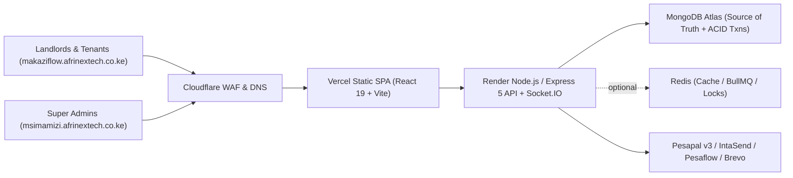

# MakaziFlow System Architecture

## Overview

MakaziFlow is a multi-tenant rental and property management SaaS platform built as a modular MERN monolith with clear tenant-isolation boundaries, an independent Super Admin operations portal (**Msimamizi**), multi-gateway payment processing, and progressive scalability infrastructure.

## Core Subsystems

1. **Client Tier (`client/`)**: React 19, Vite 7, Tailwind CSS v4, TanStack Query, Wouter routing, Recharts analytics, Socket.IO client (`client/src/lib/socket.js`), and SSE stream hook (`client/src/hooks/useSupportStream.js`).
2. **API & Domain Tier (`server/`)**:
   - **Boot & Middleware (`server/server.js`)**: Trust-proxy configuration (`1`), `requestContextMiddleware` (`X-Correlation-Id` + per-route timeouts), CORS allowlisting, Helmet CSP, express-rate-limit, `sanitizeRequest` (MongoDB `$`/`.`/`__proto__` stripping), Cookie Parser, Maintenance Mode enforcement, and graceful `SIGTERM`/`SIGINT` shutdown.
   - **Domain Services (`server/services/`)**: `PaymentService`, `subscriptionService`, `invoiceService`, `cacheService`, `cronLockService`, `dlqService`, `migrationService`, `metricsService`, `featureFlagService`, `socketService`, and `supportRealtimeService`.
3. **Persistence Tier**: MongoDB Atlas via Mongoose 9 with pooled connections (`maxPoolSize: 5` serverless / `10` standard), optional multi-document ACID transactions (`runWithOptionalTransaction`), and append-only `FinancialAuditEntry` ledger.
4. **Optional Acceleration & Worker Tier**: Optional `ioredis` caching and `bullmq` queues (`server/worker.js`) that fall back cleanly to MongoDB atomic locks (`CronLock`) and in-memory/async execution when `REDIS_URL` is absent.
